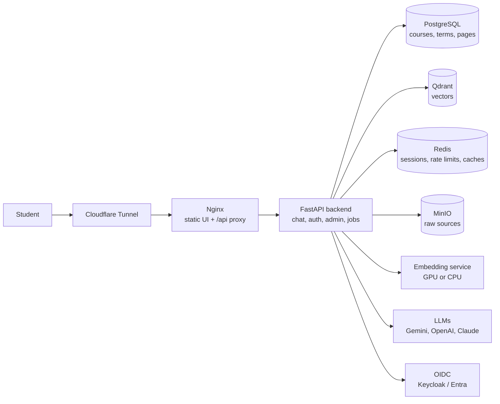

#  GoldenGuide

> A grounded academic assistant for Wilfrid Laurier University students.

GoldenGuide answers questions about courses, term offerings, prerequisites, registration, programs,
policies, deadlines and university services. Every answer is built only from official WLU sources
(the WLU websites, the Academic Calendar and LORIS registration data) and links to the pages it
used, so students can always check the original.

It is a retrieval-augmented generation (RAG) system with one important difference from a typical
chatbot: **factual questions are answered from typed database queries**, not from whatever text a
vector search happens to find. "Which CP sections run on Fridays this winter?" becomes a precise
PostgreSQL lookup; "how do I appeal a grade?" uses hybrid semantic search with reranking. The
answer model only ever sees evidence GoldenGuide actually retrieved.

**Live:** [askgoldenguide.ca](https://askgoldenguide.ca) · **Docs:** [`docs/`](docs/README.md) ·
**Design:** [software design document (PDF)](docs/sdd/GoldenGuide-SDD.pdf)

---

## What students get

- **Full current-term information.** Sections, CRNs, meeting times, rooms, instructors, seats and
  waitlists from LORIS, shown as exact tables rather than retyped text.
- **The whole Academic Calendar.** Course descriptions, prerequisites, corequisites, exclusions,
  credits, programs and requirements, for the right academic year.
- **University services and policies.** Deadlines, registration, appeals, student services and
  more, crawled from WLU's websites and cited inline.
- **Answers that say what they don't know.** "No records found", "this can't be looked up yet", "a
  source was unavailable" and "results were limited" are reported as different things. A failed
  lookup is never presented as "this doesn't exist", and GoldenGuide never invents courses, terms,
  prerequisites, policies or links.
- **Streaming answers** that start within seconds, with citations and working links.

## Engineering highlights

| | |
| --- | --- |
| **Hybrid retrieval** | Deterministic entity extraction (no LLM) → schema-validated LLM query plan → typed SQL for facts and/or Qdrant hybrid search (dense MiniLM + sparse SPLADE + ColBERT multi-vector) → cross-encoder rerank → whole-page expansion → grounded generation. A failing semantic search falls back to a simpler retrieval profile. [More](docs/chat-pipeline.md) |
| **Hexagonal architecture** | Domain, application, infrastructure and API layers with ports and adapters; one composition root (`dependency-injector`) picks every concrete adapter. Swapping an LLM, vector store or object store is an adapter plus a YAML change. [More](docs/architecture.md) |
| **Config-driven behaviour** | Layered YAML validated into typed Pydantic settings: providers, retrieval profiles, chunking, enrichment templates and prompts are configuration, not code. Secrets only come from the environment. [More](docs/configuration.md) |
| **Reliable ingestion** | Every crawl, import and indexing step is a tracked background job with batches, heartbeats, crash recovery and `fresh` / `update` / `retry` modes, so failed work is retried without redoing what succeeded. Runs nightly from GitHub Actions. [More](docs/ingestion.md) |
| **Authentication** | OpenID Connect (PKCE, nonce-verified ID tokens) with server-side Redis sessions and explicit roles (admin today). Keycloak is the identity provider; the provider-neutral design means WLU **Microsoft Entra ID** sign-in for students and faculty is largely a configuration change. Scoped, hashed service keys for automation. [More](docs/security.md) |
| **Built to scale out** | Stateless API (sessions, OAuth state and rate limits in Redis), replica-safe jobs, and every service in its own container and Compose profile, so the GPU embedding box, data stores and API can run on different machines over Tailscale today. Ports map directly to AWS managed services (planned). [More](docs/architecture.md#scaling) |
| **Observability** | Structured JSON logs across all machines (structlog → Alloy → Loki), OpenTelemetry traces (→ Collector → Jaeger), Grafana linking every log line to its trace. Every error returns a `request_id` and `trace_id`. [More](docs/observability.md) |
| **Easy to run** | One requirement: Docker. Clone, copy `.env.dev.example` to `.env`, add an LLM key, `docker compose up`. A CPU-only embedding machine works with limits. [More](docs/getting-started.md#cpu-only-machines) |
| **Tested** | Unit tests at the ports, integration tests against real PostgreSQL/Redis/Qdrant (shared contract suites for adapters), a retrieval-quality evaluation, and a CI gate running every test on each pull request. [More](docs/testing.md) |

## Architecture



A modular monolith plus a separate embedding service, with independently operated data stores. The
full picture, including jobs, observability and the backend layers, is in
[architecture](docs/architecture.md).

## Technology

| Concern | Choice |
| --- | --- |
| Language & packaging | Python 3.14, [uv](https://docs.astral.sh/uv/) with a locked `uv.lock` and one dependency group per service |
| API | FastAPI, Uvicorn, Pydantic v2, NDJSON streaming |
| Architecture | Hexagonal / DDD, `dependency-injector`, provider registries |
| Configuration | OmegaConf layered YAML → typed Pydantic settings; secrets via a `SecretReader` port |
| Structured data | PostgreSQL 16, SQLAlchemy 2 (async, asyncpg), Alembic migrations |
| Vector search | Qdrant: dense, sparse (SPLADE) and multi-vector (ColBERT) collections, hybrid fusion |
| Models | Local embedding service (sentence-transformers, FastEmbed: MiniLM, ColBERT, SPLADE, cross-encoder rerankers) on GPU or CPU; Gemini, OpenAI and Anthropic Claude adapters; the answer model is chosen per retrieval profile |
| Objects | MinIO (S3-compatible) |
| State & caching | Redis with AOF persistence |
| Collection | Async crawler on httpx (robots.txt, ETag/Last-Modified), BeautifulSoup, pypdf, LangChain text splitters |
| Authentication | OIDC with Authlib + joserfc; Keycloak (staging and production), Microsoft Entra ID (planned) |
| Observability | OpenTelemetry, Jaeger, Grafana Alloy, Loki, Grafana, structlog |
| Infrastructure | Docker Compose profiles, per-container CPU/RAM limits, Tailscale for multi-machine, Cloudflare Tunnel for public ingress |
| Quality | pytest (unit + integration, `pytest-asyncio`, `pytest-cov`) run on every pull request by GitHub Actions; Ruff and Pyright are installed for manual checks |

## Quick start

```sh
git clone https://github.com/b4sleal/GoldenGuide.git && cd GoldenGuide
cp .env.dev.example .env                  # working local defaults; add MODEL_PROVIDER__GEMINI__API_KEY
docker compose -f docker-compose.yml -f docker-compose.dev.yml --profile all-dev --profile embedding-gpu up -d --build
```

Open http://localhost:8080. Without an NVIDIA GPU, use `--profile embedding-cpu` instead (with limits, see
[getting started](docs/getting-started.md#cpu-only-machines)). Loading data and every service URL are in
[getting started](docs/getting-started.md). Staging and production use their own env files and Cloudflare
tunnels ([environments](docs/environments.md));
type hints from the Docker venv without a local `.venv` are in
[editor setup](docs/getting-started.md#editor-setup-type-hints-from-docker).

## Status and roadmap

Implemented:

- Streaming chat with inline citations, link resolution and record tables
- Structured retrieval for courses, course terms (LORIS sections) and programs
- Hybrid semantic retrieval with cross-encoder reranking and whole-page expansion
- Source collection for the Academic Calendar, three WLU websites and LORIS, with tracked jobs
- Indexing of courses, course terms and pages; admin document uploads
- OIDC sign-in via Keycloak with Redis-backed sessions; admin role and scoped service keys
- Nightly ingestion from GitHub Actions; CI running every test on each pull request
- Docker Compose for development, staging and production, across multiple machines

Planned:

- **Microsoft Entra ID sign-in** for WLU students and faculty (provider-neutral contracts already in
  place)
- **Course syllabi and faculty documents** as sources, and faculty-specific roles
- **AWS deployment** (RDS, ElastiCache, S3, ECS, Secrets Manager)
- Question routing to cheaper retrieval profiles for simple questions
- Chat feedback, a readiness endpoint, and a durable job worker
- Open decision: whether chat should require a student sign-in (WLU's call)

## Documentation

Start at [`docs/README.md`](docs/README.md), which points to the right page for what you want to do: run it,
understand it, change it, deploy it or look after it ([environments](docs/environments.md),
[operations](docs/operations.md)). New to the university's systems? See the [glossary](docs/glossary.md).
