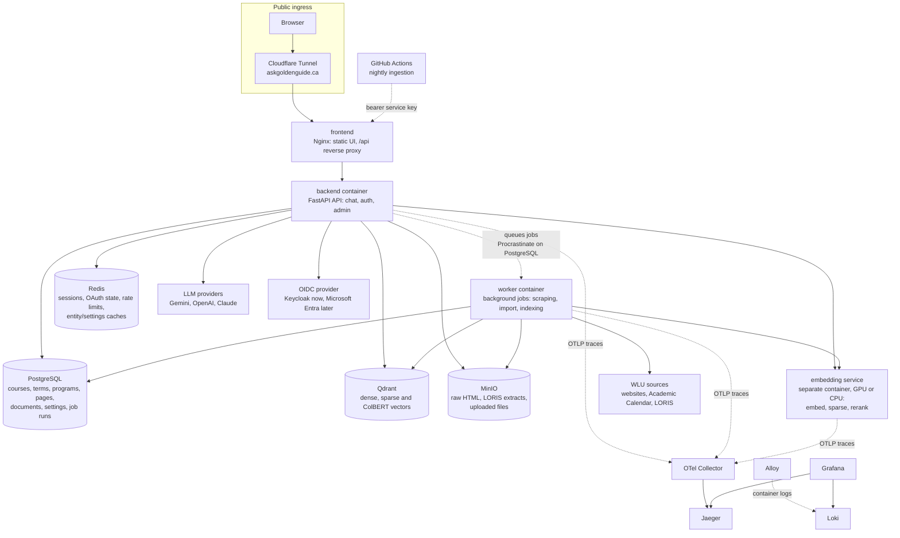
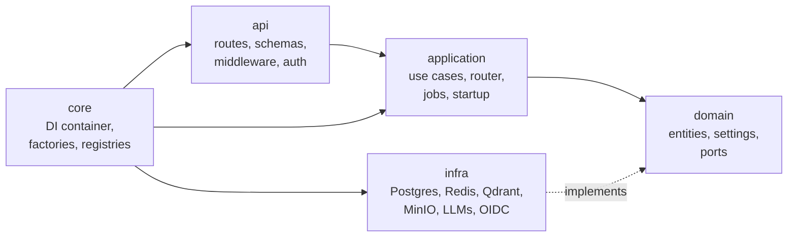

# Architecture

> **Audience:** Developers and reviewers.

GoldenGuide is a **modular Python/FastAPI monolith** with a separate embedding service and
independently operated data stores. It is deliberately not split into microservices: every part
already runs as its own container and can move to its own machine, but the API stays one codebase
until a real deployment or scaling requirement justifies more.

- [System overview](#system-overview)
- [Services](#services)
- [Data stores and what they hold](#data-stores-and-what-they-hold)
- [Backend layers (hexagonal architecture)](#backend-layers-hexagonal-architecture)
- [Provider registries and dependency injection](#provider-registries-and-dependency-injection)
- [Academic domain model](#academic-domain-model)
- [Failure semantics](#failure-semantics)
- [Scaling](#scaling)
- [Repository layout](#repository-layout)

Related: [chat pipeline](chat-pipeline.md) · [ingestion](ingestion.md) ·
[configuration](configuration.md) · [security](security.md) · [docker](docker.md).

---

## System overview



## Services

Every box below is its own container with CPU/RAM limits, a healthcheck where meaningful, and a
Compose profile, so it can run on the same machine or a different one.

| Service | Built from | Role |
| --- | --- | --- |
| `frontend` | `docker/frontend/` (Nginx) | Serves the React app built from `frontend/` (SPA fallback to `index.html`) and proxies `/api` to the backend, including streamed responses. The browser only ever talks to this origin. |
| `backend` | `Dockerfile` (`backend` group) | FastAPI API: chat, sign-in, admin endpoints. Records and queues background jobs; with `JOBS__EXECUTION=in_process` (development) it also runs them. |
| `worker` | Same image as backend (`python -m backend.worker`) | Runs queued jobs (scraping, imports, indexing) with its own CPU/RAM limits, so jobs never slow chat. Parses in a pool of child processes. Profile `worker`; see [Background jobs](#background-jobs). |
| `provision` | Same image as backend | One-shot job before the API starts: Alembic migrations, MinIO buckets, Qdrant collections (version-checked). Idempotent. |
| `local-embedding-gpu` / `-cpu` | `Dockerfile` (`embedding-gpu` / `embedding-cpu` group) | Separate FastAPI service in `src/embedding_service/`: `/embed/query`, `/embed/documents`, `/sparse/*`, `/rerank`, protected by an API key. Loads MiniLM, ColBERT, SPLADE and a cross-encoder at startup. |
| `postgres` + `db-bootstrap` | `postgres:16` | Authoritative structured data. `db-bootstrap` creates the databases (dev also creates `goldenguide_test`). |
| `qdrant` | Pinned image digest | Vector collections. |
| `minio` | Pinned image digest | S3-compatible object storage. |
| `redis` | `redis:7-alpine` | Session/OAuth/rate-limit state (critical) and caches (optional). AOF persistence. |
| `keycloak` | `quay.io/keycloak/keycloak` | OIDC identity provider with a `goldenguide` realm and an admin role. Development uses `deploy/keycloak/realm.json` (optional, `--profile auth`); staging and production use `realm.hosted.json`. Runs in Keycloak's development mode ([environments](environments.md#keycloak-for-staging-and-production)). |
| `otel-collector`, `jaeger`, `loki`, `alloy`, `grafana` | Upstream images | Traces, logs and the dashboards that link them ([observability](observability.md)). |
| `tailscale` | Upstream image | Optional private network between machines. |
| `tunnel` | `cloudflare/cloudflared` | Optional public ingress without opening inbound ports. |

Why the embedding service is separate: it carries torch/CUDA (several GB) and GPU access, has a
different scaling profile than the API, and can sit on the one machine that has a GPU while the API
runs elsewhere. CPU and GPU builds are mutually exclusive dependency groups in `pyproject.toml`.

## Data stores and what they hold

| Store | Contents | Failure policy |
| --- | --- | --- |
| **PostgreSQL** | `courses` (Academic Calendar), `course_terms` + `course_term_meetings` + `course_term_faculty` (LORIS sections), `wlu_pages` (calendar faculties, departments, programs and glossary; website pages); courses and calendar pages carry an `academic_level` (undergraduate / graduate), `scrape_pages` (crawl frontier), `documents`, `settings` (runtime defaults, versioned), `job_runs` / `job_batches` | Authoritative. Schema changes only through Alembic migrations. |
| **Qdrant** | Derived vectors per collection layout (`dense`, `sparse`, `multi`, `multi_sparse`), each point carrying source id, URL, title, academic level (when the record has one) and chunk text | Rebuildable from PostgreSQL. Collection versions must match configuration or provisioning stops. |
| **MinIO** | Raw crawled HTML, LORIS extracts, uploaded original files | Source of truth for re-parsing without re-crawling. |
| **Redis** | Sessions, in-flight OAuth logins (single use), rate-limit windows; caches for the entity lookup, settings and courses | Session/OAuth/rate-limit failures **fail closed**. Cache misses or outages fall back to PostgreSQL. |

Vector indexing success is never reported as scraping or database success (and vice versa): each
stage records its own job outcome ([ingestion](ingestion.md)).

## Backend layers (hexagonal architecture)



Dependencies point inward only. `import-linter` is a dev dependency, but no layer contracts are
configured yet, so the rule is currently enforced by review rather than by CI.

| Layer | Path | Owns |
| --- | --- | --- |
| **Domain** | `src/backend/domain/` | Entities (`Course`, `CourseTerm`, academic terms, WLU pages, retrieval plans, evidence and outcomes, jobs, principals), typed settings, and **ports** (Protocols) for repositories, stores and providers. No framework or vendor code. |
| **Application** | `src/backend/application/` | Use cases (chat, scraping, ingestion, settings), the query router (extraction → planning → compilation → retrieval → evidence), job runners and startup workflows. Talks only to domain ports. |
| **Infrastructure** | `src/backend/infra/` | Adapters: SQLAlchemy/asyncpg repositories and dialect operations, Redis stores, Qdrant, MinIO, LLM and embedding clients, text splitters, Authlib OIDC client. |
| **API** | `src/backend/api/` | FastAPI routes, request/response schemas, NDJSON streaming, middleware (request context, error boundary, security headers, HTTP-only), auth dependencies and rate limiting. |
| **Composition root** | `src/backend/core/` | `dependency-injector` container, wiring, factories and provider registries. The only place that picks concrete adapters. Also the provision and service-key entry points. |
| **Shared** | `src/backend/shared/`, `src/goldenguide_common/` | Configuration loading, secret reading, structured logging and telemetry, used by both the backend and the embedding service. |

Swapping a provider (another LLM, S3 instead of MinIO, a managed vector store) means writing an
adapter for an existing port and registering it. Use cases don't change.

## Provider registries and dependency injection

Configuration names *which* implementation runs; the composition root turns that name into an
object:

```
configs/catalogs/providers/*.yml   what exists      e.g. llm.gemini_fast: {provider: gemini, model: ...}
configs/catalogs/active/infra.yml  what is in use   e.g. db.app -> postgres_goldenguide
core/factories + registries        name -> adapter  e.g. "gemini" -> GeminiLLM
core/di                            wiring           adapters injected into use cases via ports
```

Application code never reads environment variables or constructs adapters. Secrets reach adapters
through the `SecretReader` port (environment variables today; AWS Secrets Manager or Parameter
Store later without touching callers). See [configuration](configuration.md).

## Academic domain model

- **`Course`** is a stable identity from the Academic Calendar (e.g. `CP264` in an academic year):
  description, prerequisites, corequisites, exclusions, credits, notes.
- **`CourseTerm`** is a term-specific offering from LORIS (a section with a CRN): meetings, rooms,
  instructors, seats, waitlist, delivery, restrictions. Credits and prerequisites can differ from
  the calendar and between terms. The two are never collapsed.
- **Academic terms** are resolved in code (`AcademicTermResolver`), never by the LLM: "next term",
  "fall", "this year" become concrete term codes based on today's date.
- **WLU pages** hold programs, policies, services, glossary entries and general website content,
  each with its source URL.
- **Provenance is kept.** The Academic Calendar and LORIS can disagree; both are stored with their
  source and neither silently overwrites the other. Imports distinguish insert-only, upsert,
  fill-missing and conditional updates.

## Failure semantics

These outcomes are distinct everywhere in the code and in what the student is told:

| Outcome | Meaning | Student sees |
| --- | --- | --- |
| **Completed, no records** | The lookup ran and found nothing | "No records found" for that part |
| **Unsupported** | The plan asked for something the system can't query yet | That part can't be answered |
| **Failed** | A provider or database failed | That part couldn't be checked right now |
| **Incomplete / truncated** | Retrieval hit a limit | Results are partial; more exist |

A failed lookup is never presented as "this doesn't exist". One failing source never sinks the
whole answer: the failure is recorded and reported, and the rest of the answer proceeds.

Streaming has its own contract because HTTP status can't change after headers are sent: every
stream ends with an explicit `ok` or `error` event ([API](api.md#chat-stream-contract)).

## Background jobs

Crawls, imports and indexing are **jobs**: an admin endpoint records a run in `job_runs` and answers
`202` with a status URL at once ([ingestion](ingestion.md#jobs-modes-and-retries)). Where the job runs
is a setting, `system.jobs.execution` (`JOBS__EXECUTION`):

| Mode | Where jobs run | Use |
| --- | --- | --- |
| `worker` | `worker` containers. The API queues `run_job(run_id)` on [Procrastinate](https://procrastinate.readthedocs.io/), an async job queue stored in the same PostgreSQL; a worker claims and runs it. | Staging and production |
| `in_process` | asyncio tasks inside the API process | Development (no extra container) |

Responsibilities are split on purpose:

| Concern | Owner |
| --- | --- |
| Delivering a job to a worker: claiming, shutdown, dead-worker detection | Procrastinate (`procrastinate_*` tables, migration 0005) |
| What happened: status, batches, partial success, summary, audit, duplicate-run `409` | `job_runs` / `job_batches` (the status endpoint reads these) |
| The work | The job classes in `application/use_cases/`, unchanged by where they run |

How it fits the layers:

- **Jobs are data.** Each submission stores a typed `JobRequest` (`domain/entities/job_requests.py`:
  a `JobKey` plus its parameters) on the run, so any process can rebuild the job from the run alone.
  The queue carries only the run id.
- **`JobRegistry`** maps each `JobKey` to the job that runs it and refuses to start if one is
  missing; **`JobExecution`** runs a run to a final status (heartbeats; a run that ends without an
  outcome, raises or is cancelled is failed; a run that is no longer queued is skipped, so a job is
  never run twice). Both are application services behind domain ports (`JobLauncher`, `JobRunExecutor`).
- **Launchers** (`infra/jobs/`) are chosen in the composition root: `InProcessJobLauncher` or
  `ProcrastinateJobLauncher`. Application code never imports Procrastinate.
- **CPU-bound parsing** goes through the `ComputeExecutor` port: threads in the API (keeps the event
  loop responsive), a process pool in the worker (`system.jobs.worker.compute_processes`, parses on
  several cores). Offloaded parsers are module-level functions on plain data, so they can be pickled.
- **Recovery.** A worker that dies leaves its run RUNNING without heartbeats; the zombie sweep fails it
  after `zombie_timeout_minutes` (5). Queued runs may wait behind long jobs and are failed only after
  `queued_timeout_minutes` (24 h). A periodic worker task re-queues Procrastinate jobs of dead workers;
  that never re-runs a job (its run is no longer queued), and failed jobs are not retried
  automatically: resubmit them (imports are idempotent with `mode=update`).
- **Known gap.** The run is recorded (SQLAlchemy) and queued (psycopg) on two connections, so not in
  one transaction. If the API dies between the two, the run stays queued until the 24 h timeout fails it.

## Scaling

- **Stateless API.** Sessions, OAuth state and rate limits live in Redis, so any number of backend
  replicas can sit behind the proxy. Rate limits hold across replicas.
- **Jobs are replica-safe.** Two runs of the same job are refused across instances (PostgreSQL
  advisory lock); heartbeats and a zombie sweep recover runs from a crashed worker. Add workers
  (`--scale worker=N`, or on other machines) to run more jobs at once; each run is claimed by exactly one.
- **Every service has its own profile**, so stores, the embedding GPU box and the API can run on
  different machines today. Each machine's `tailscale` container joins a private Tailscale network
  and forwards its services by name; clients address other machines as `<machine>-docker.<tailnet>.ts.net`
  ([docker](docker.md#over-tailscale)). Verified with the data stores, provisioning and GPU
  embeddings on one machine and the backend, frontend and observability on another.
  This places services on machines; it does not run copies of them. Calling machines also need the
  Tailscale client on the host today (a Docker-only gateway is future work, [docker](docker.md#over-tailscale)).
- **Future: replicas and load balancing.** Running several copies of a service (e.g. five GPU
  embedding machines, several backends) behind one name needs an orchestrator. Docker Swarm is the
  smaller step: it deploys from Compose-style files, gives services cluster-wide names and spreads
  `replicas` across machines with built-in load balancing. Kubernetes is the industry standard, with
  autoscaling and better GPU scheduling, at more operational cost. Both expect Linux hosts and an image
  registry; the stateless API and replica-safe jobs above already allow it.
- **Cloud path.** The ports map directly to managed services: RDS for PostgreSQL, ElastiCache for
  Redis, S3 for MinIO, ECS/Fargate tasks for the API and provision job, a GPU instance for
  embeddings, and Secrets Manager behind `SecretReader`. AWS deployment is planned, not implemented.

## Repository layout

```
GoldenGuide/
├── src/
│   ├── backend/              # FastAPI application: domain / application / infra / api / core / shared
│   ├── embedding_service/    # Standalone embedding, sparse-vector and rerank API (GPU or CPU)
│   ├── goldenguide_common/   # Code shared by backend and embedding service (config, logging, contracts)
│   └── frontend/             # Static demo UI (HTML/CSS/JS)
├── configs/
│   ├── base/                 # System settings, AI behaviour (prompts), embedding service settings
│   ├── catalogs/             # Providers, profiles, router, scraping targets, lexicon, active selections
│   └── environments/         # development / staging / production overrides
├── tests/
│   ├── backend/unit/         # Fast tests mirroring src/backend (no network)
│   ├── backend/integration/  # Tests against real PostgreSQL, Redis and Qdrant
│   └── eval/                 # Retrieval-quality evaluation against a running stack
├── docker/                   # Frontend image + Nginx template, Postgres bootstrap, dev start script, BuildKit config
├── deploy/                   # Config mounted into third-party services: Alloy, Loki, Grafana data sources,
│                             #   OpenTelemetry Collector, Keycloak realms (development and hosted)
├── scripts/                  # nightly_ingestion.py (used by GitHub Actions)
├── .github/workflows/        # tests.yml (all tests on every PR), nightly-ingestion.yml
├── docs/                     # This documentation
├── Dockerfile                # All Python images (development, builder and runtime stages)
├── docker-compose.yml        # Runtime stack: services, profiles, limits, healthchecks
├── docker-compose.dev.yml    # Development overrides: source mounts, reload, shared dev venv
├── docker-compose.prod.yml   # Production overrides: required credentials, no fallbacks
├── .env.dev.example          # Development variables with working local defaults (copy to .env)
├── .env.staging.example      # Staging variables, credentials blank (copy to .env.staging)
├── .env.prod.example         # Production variables, credentials blank (copy to .env.prod)
├── wslconfig.example         # Windows WSL 2 CPU/RAM budget
├── alembic.ini               # Database migrations
└── pyproject.toml / uv.lock  # Dependency groups per service and tool configuration
```
