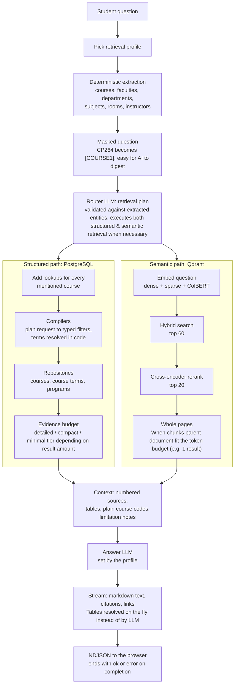

# How a question is answered

> **Audience:** Developers.

GoldenGuide is a retrieval-augmented generation (RAG) system with one important difference from a
typical chatbot: factual questions ("what are the prerequisites for CP264?", "which CP sections run
on Fridays this winter?") are answered from **typed database queries**, not from whatever text a
vector search happens to return. Semantic search is used where it fits (policies, services, open
questions), and the answer model only ever sees evidence that GoldenGuide actually retrieved.

- [Overview](#overview)
- [1. Retrieval profile](#1-retrieval-profile)
- [2. Deterministic entity extraction](#2-deterministic-entity-extraction)
- [3. LLM query plan](#3-llm-query-plan)
- [4a. Structured path: compilers and repositories](#4a-structured-path-compilers-and-repositories)
- [4b. Semantic path: hybrid search, rerank, whole pages](#4b-semantic-path-hybrid-search-rerank-whole-pages)
- [5. Context assembly and limitations](#5-context-assembly-and-limitations)
- [6. Generation and streaming](#6-generation-and-streaming)
- [Where the code is](#where-the-code-is)

---

## Overview



## 1. Retrieval profile

A **retrieval profile** (`configs/catalogs/profiles/retrieval_profile.yml`) bundles everything that
decides cost and depth: which vector collection, which search strategy, the database evidence
budget, and the answer LLM. A profile can also name fallback profiles that semantic search tries
if it fails (`deep_cloud` falls back to `balanced_cloud`). The answer LLM has no fallback model
configured today. Every question currently uses
`deep_cloud`; routing easy questions to cheaper profiles is a configuration change, not a code
change ([configuration](configuration.md#retrieval-profiles)).

## 2. Deterministic entity extraction

No LLM is involved. Matchers in `application/services/router/extraction/matchers/` recognize:

| Matcher | Finds |
| --- | --- |
| `course_matcher` | Course codes (`CP264`, `cp 264`) and lexicon aliases (`comp sci 264`), kept only if the course exists |
| `lexicon_matcher` | Faculties, departments and subjects by exact name or WLU alias from `configs/catalogs/text_enrichment/wlu_lexicon.yml` (e.g. "fhss") |
| `department_hint_matcher` | Misspelled or truncated department names (fuzzy); passed to the planner as hints, never masked |
| `room_matcher` | LORIS room identifiers as students write them |
| `instructor_matcher` | Full names of instructors teaching LORIS sections |

Matchers check against an **entity lookup** built from the database (every known course, subject,
program, room and instructor), not regexes alone, so only real entities are recognized. That lookup
is a whole-catalog scan, so it is cached in Redis; if Redis is down, the process falls back to its
last copy or to PostgreSQL, so a cache outage slows questions down rather than failing them.

Recognized entities are **masked** (`[COURSE1]`, `[DEPARTMENT1]`) before planning. The planner can
refer only to masks the extractor produced, so it cannot invent a course.

## 3. LLM query plan

The router LLM (`ai_behavior.router_llm` in `configs/base/ai_behavior.yml`) turns the masked
question into a `PreLLMExtraction`: a list of retrieval requests, each with a **source**
(`courses`, `course_terms`, `wlu_pages`, `vector`), an **operation** (`lookup`, `filter`,
`related`, `semantic`), entity masks and filters (term, credit, level, days, rooms, instructors).

LLM output is untrusted input. It passes through:

1. **Lenient parsing** (`planning/llm/response_model.py`): repairs only the shapes LLMs commonly get
   wrong (a single value where a list is expected), driven by the domain model's types.
2. **Validation** (`planning/llm/plan_validation.py`): every operation must be supported by its
   source; every mask must be one the extractor produced; subject codes are mapped back to masks.
3. **Fallback**: if any validator rejects the plan, a conservative plan runs instead (look up the
   mentioned courses, otherwise semantic search).

## 4a. Structured path: compilers and repositories

`application/use_cases/chatbot/retrieval_orchestrator.py` runs the structured requests:

1. **Enrichment.** Every course the student mentioned gets a course lookup and a current-term
   offering lookup, even if the planner forgot one ("is CP220 hard?" still needs CP220's record).
2. **Compilation** (`router/compilation/`). `CourseQueryCompiler` and `CourseTermQueryCompiler`
   turn each request into typed repository filters, one per (term, course or subject). **Terms
   are resolved in code** by `AcademicTermResolver`, never by the LLM. A filter the database can't
   execute raises, and the request is reported as *unsupported* rather than silently ignored.
3. **Repositories** (`router/retrieval/`) query PostgreSQL through domain ports. Each request
   fetches one record beyond its limit, which proves more exist and lets the answer say
   "results limited".
4. **Evidence budget** (`services/chatbot/db_evidence_selector.py`). Every record has three
   renderings: detailed, compact and minimal. The whole set uses the richest tier the profile's
   `db_evidence` budget allows. If even the minimal tier doesn't fit, the request is reported as
   unsupported; records are never silently dropped.

Duplicate requests (planner + enrichment) run once. Program pages discovered by a filter become
entities that later requests can look up by id. A failing request is recorded as *failed* and the
rest of the answer continues.

**Tables.** LORIS sections and planned listings ("all CP courses") are rendered as tables built
from the exact records. The model places a table by writing `{{TABLE:n}}` instead of retyping rows,
which keeps CRNs, times and seats exact. Tables the model doesn't place are still shown after the
answer.

## 4b. Semantic path: hybrid search, rerank, whole pages

Runs when the plan asks for semantic search, or as a fallback when the structured path found
nothing and the plan allows it (`services/chatbot/`, `use_cases/chatbot/context_resolver.py`):

1. **Embed** the question with every vector type the profile's collection has: dense (MiniLM),
   sparse (SPLADE) and multi-vector (ColBERT), via the embedding service.
2. **Hybrid search** in Qdrant fuses the three similarities (top 60 for `deep_cloud`).
3. **Cross-encoder rerank** (`reranking.py`) reads the question and each candidate together and
   keeps the best 20. Fused similarity finds candidates; the cross-encoder decides which actually
   answer the question (it can tell "important dates and deadlines" from a page that merely lists
   many dates). Duplicate chunks are dropped.
4. **Whole pages** (`whole_documents.py`). Chunks answer "find the passage" but fail "give me
   everything", such as a list of deadlines spread over many chunks. When reranking narrows the
   answer to a few pages that fit the budget together, the model gets each page complete and in
   order; otherwise the chunks are kept.

If the profile's provider fails at any step, the next profile in its fallback chain is tried. If
semantic search fails entirely, the answer is told so (see below) instead of answering from less.

## 5. Context assembly and limitations

- Structured evidence comes first, then semantic results. Evidence blocks carry numbered
  `--- SOURCE n ---` headers. All LORIS registration sections share one citation entry,
  **LORIS - Registration**, at the configured institution registration URL; their individual
  records, titles and table rows remain available to the model. Other sources keep their own IDs.
  This consolidation happens before generation, so streamed citations and saved references agree.
  Older history responses consolidate registration references and remap citation IDs together;
  the stored rows are not rewritten.
- **Links.** The model's context holds no Markdown links: stored `[CP164](@@n@@)` links become plain
  labels (`CP164`), and course codes with an Academic Calendar page are collected (`course_links`).
  The stream links every mention of a known course code (2-4 letter subjects, e.g. `GENG135`), so the
  model never copies, retypes or invents a link, and a bracketed code with no link is shown plainly.
- **Limitation notes** (`retrieval_limitations.py`). Every request has an outcome: completed (with a
  count and whether it was truncated), unsupported, or failed. The context tells the answer model
  which parts of the question could not be answered and why, so it says so instead of answering from
  unrelated records. "No records found", "unsupported", "a provider failed" and "incomplete" stay
  distinct all the way to the student.
- The answer prompt also receives today's date and the terms in scope, computed in code.

## 6. Generation and streaming

`application/use_cases/chatbot/rag_chatbot.py` formats the answer prompt (runtime settings,
editable by admins) and streams the model's output through a chain applied to every chunk:

```
citations ([n] / [n, m] / [Source n] -> citation event) -> links (course codes -> calendar URLs) -> tables ({{TABLE:n}} -> table event)
```

Each stage holds back partial markers across chunk boundaries and releases them in order. The
browser receives newline-delimited JSON: `status` events (progress) and the `sources` list first
(so citation chips can show their sources while the text streams), then `text`, `citation`, `table`,
and a terminal `ok` or `error` added by `api/streaming.py`
([stream contract](api.md#chat-stream-contract)).

The prompt is an `LLMRequest` (`domain/entities/llm.py`): fixed `system` instructions plus
role-separated messages (earlier turns, then this turn's evidence and question). Adapters translate
it to each vendor's format (Gemini `system_instruction` + `contents`, OpenAI messages, Claude
`system`). Keeping `system` identical between questions lets provider prompt caching apply.

**Progress (`status` events).** Retrieval runs as a task while `RagChatbot` streams the stages it
reports through the `TurnRecorder`: `understanding` at once, `searching` once per source the
validated plan actually searches (`courses`, `course_terms`, `wlu_pages`, `vector`), then `writing`.
Codes only; the client owns the wording.

Every answer logs `retrieval_ms` (routing + structured + vector), `first_chunk_ms`,
`generation_ms` and `total_ms`, correlated by `trace_id` ([observability](observability.md)).

## 7. Conversations and follow-up questions

Every turn is stored (`application/use_cases/chatbot/chat_turn.py`, app database tables
`conversations`, `chat_messages`, `message_feedback`):

- The question is saved **before** answering; the answer is saved in a `finally`, however the stream
  ends: `complete`, `error` (with `error_type`, `error_code`, `error_message`) or `interrupted`
  (student disconnected). The final save runs as a shielded task so a disconnect cannot cancel it.
- Assistant messages keep diagnostics for review: query plan, retrieval outcomes, sources, profile,
  settings version, per-stage timings, `trace_id`, `request_id`, and the carried entities (below).
  The `TurnRecorder` collects these stage by stage, so a failure keeps whatever ran before it.
- History is best-effort: if storing or loading fails the answer still streams and the failure is
  logged once (`chat_history_save_failed`, `chat_history_load_failed`).

When a conversation continues (`conversation_id` in the request):

1. **Answer model:** the last completed question/answer pairs (`catalogs/chat/chat.yml`:
   `max_turns`, `max_chars_per_message`) become earlier messages of the `LLMRequest`. Failed or
   interrupted turns are skipped with their question. Earlier answers are context for meaning only:
   retrieval runs again and citations always come from this question's evidence.
2. **Router:** the previous answer's carried entities are offered under `[EARLIER_...]` masks
   (`application/services/router/conversation_entities.py`), so "is it offered in winter?" can plan a
   `course_terms` lookup on `[EARLIER_COURSE1]`. Plan validation still rejects any mask outside the
   current and carried sets; the fallback plan and automatic course lookups use only the current
   question's entities. A turn carries forward its own entities plus the earlier ones its plan used,
   so a change of topic ends the old context.

Ownership is the anonymous `gg_client` device cookie (stored as a SHA-256 hash); see
[security](security.md#access-policy). Retention (deleting old conversations) is planned, not built.

## Where the code is

| Step | Path |
| --- | --- |
| Chat endpoint and streaming protocol | `src/backend/api/routes/chat.py`, `src/backend/api/streaming.py`, `src/backend/api/cookies.py` |
| Stored turns, history, follow-ups | `src/backend/application/use_cases/chatbot/chat_turn.py`, `conversation_history.py`, `turn_recorder.py` |
| Carried entities | `src/backend/application/services/router/conversation_entities.py` |
| Orchestration | `src/backend/application/use_cases/chatbot/rag_chatbot.py`, `retrieval_orchestrator.py` |
| Extraction | `src/backend/application/services/router/extraction/` |
| Planning | `src/backend/application/services/router/planning/llm/` |
| Compilation | `src/backend/application/services/router/compilation/` |
| Structured retrieval | `src/backend/application/services/router/retrieval/` |
| Evidence rendering | `src/backend/application/services/router/evidence/` |
| Semantic retrieval, rerank, whole pages | `src/backend/application/services/chatbot/`, `use_cases/chatbot/context_resolver.py` |
| Prompts | `configs/base/ai_behavior.yml` (defaults; admins can override at runtime) |
