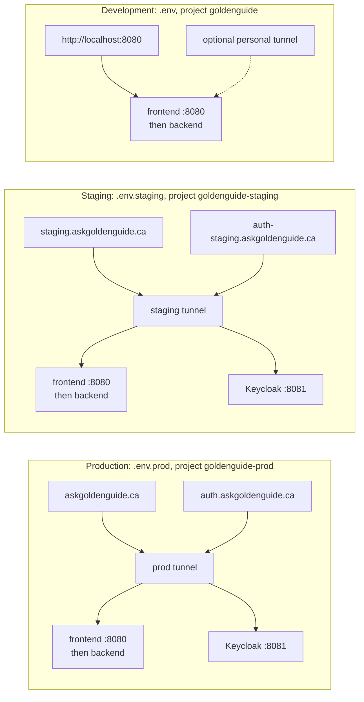

# Environments

> **Audience:** anyone who runs or deploys GoldenGuide, developers and operators alike.

GoldenGuide runs in three environments from one codebase. Each has its own env file, its own Compose project
(so its own containers and data volumes) and, when it is public, its own Cloudflare tunnel.

| | Development | Staging | Production |
| --- | --- | --- | --- |
| Purpose | Building and testing changes | Team review before release | The live site |
| Env file (template) | `.env` (`.env.dev.example`) | `.env.staging` (`.env.staging.example`) | `.env.prod` (`.env.prod.example`) |
| Compose project | `goldenguide` | `goldenguide-staging` | `goldenguide-prod` |
| Compose files | base + `docker-compose.dev.yml` | base + `docker-compose.prod.yml` | base + `docker-compose.prod.yml` |
| Public address | None by default: `http://localhost:8080` | `https://staging.askgoldenguide.ca`, intended for the team only | `https://askgoldenguide.ca` |
| Sign-in | Off by default (`LOCAL_ADMIN`); Keycloak is optional | Keycloak, hosted realm | Keycloak, hosted realm |
| Data volumes | `goldenguide_*` | `goldenguide-staging_*` | `goldenguide-prod_*` |
| Credentials | Working defaults (`admin/admin`) | Required: Compose refuses to start without them | Required: Compose refuses to start without them |



Each tunnel reaches only the stack it runs next to, because `frontend` and `keycloak` are names on that
stack's own Docker network.

- [Environment files](#environment-files)
- [Public hostnames and tunnels](#public-hostnames-and-tunnels)
- [Keycloak for staging and production](#keycloak-for-staging-and-production)
- [Deploying production](#deploying-production)
- [Frontend, proxy and tunnel](#frontend-proxy-and-tunnel)

Day-to-day running, backups, secret rotation and troubleshooting are in [operations](operations.md).
How the Compose files, profiles and images fit together is in [docker](docker.md).

---

## Environment files

Staging is a production-style copy of the stack for the whole team (QA, staff). It runs the same
Compose files as production, with its own data stores, credentials, OIDC client and tunnel, and
`APP_ENV=staging`.

| Environment | File | Template | Compose command |
| --- | --- | --- | --- |
| Development | `.env` | `.env.dev.example` | `docker-compose.yml` + `docker-compose.dev.yml` |
| Staging | `.env.staging` | `.env.staging.example` | `--env-file .env.staging`, `docker-compose.yml` + `docker-compose.prod.yml` |
| Production | `.env.prod` | `.env.prod.example` | `--env-file .env.prod`, `docker-compose.yml` + `docker-compose.prod.yml` |

- `.env` stays the development file because the tests and `uv run` read it (`tests/conftest.py`,
  `EnvSecretReader`). Its template is `.env.dev.example`.
- Every `.env.*` file except the `.example` templates is git-ignored. Never commit one. Back the real
  values up in a password manager: they are not in git.
- The staging and production templates leave every credential blank on purpose.
  `docker-compose.prod.yml` refuses to start while one is empty, so nobody deploys with `admin/admin`.
  The development template has working `admin/admin` defaults.
- `--env-file` makes Compose read that file instead of `.env`. The file sets `ENV_FILE=<its own name>`,
  which the Python services use as their `env_file`, so substitution and the containers read the
  same values. Without the flag, Compose falls back to `.env`.
- Each environment has its own Cloudflare tunnel and token (`TUNNEL_TOKEN` in its file); see
  [Public hostnames](#public-hostnames-and-tunnels).
- On dedicated hosts, save the environment's file as `.env` and drop the `--env-file` flag.
- Each environment file sets its own `COMPOSE_PROJECT_NAME` (`goldenguide-staging`, `goldenguide-prod`;
  development keeps the default `goldenguide`). Compose prefixes containers, networks and volumes with
  it, so each environment has its own data (`goldenguide-prod_pg_data`, `goldenguide_pg_data`, ...) even on
  one machine. Images are shared, since their names are fixed.
- To run two environments at the same time on one machine, also give each its own `APP_NETWORK_SUBNET` and
  host ports; they would otherwise collide. Check what Compose will apply with
  `docker compose --env-file .env.staging config`.
- PostgreSQL stores its user and password in its data directory on first start. If you copy data between
  environments, the target's `DB__POSTGRES__USER` and `DB__POSTGRES__PASSWORD` must match the copied database.
- Each environment's file sets `COMPOSE_FILE` and `COMPOSE_PROFILES` (with `COMPOSE_PATH_SEPARATOR=,`
  so the same value works on Windows and Linux), so commands need no `-f` or `--profile` flags. A
  command-line `-f` overrides `COMPOSE_FILE`, and any `--profile` replaces `COMPOSE_PROFILES`.
- Staging is configured like production (HTTPS origin, OIDC, no `LOCAL_ADMIN`), but the backend's
  startup checks (HTTPS `SITE_ORIGIN`, no `LOCAL_ADMIN`, required trace exporter) currently apply only
  to `APP_ENV=production`. Staging does not enforce them yet.

## Public hostnames and tunnels

| Environment | Hostname | Tunnel | Who can reach it |
| --- | --- | --- | --- |
| Production | `askgoldenguide.ca` | `goldenguide-prod` | Public |
| Staging | `staging.askgoldenguide.ca` | `goldenguide-staging` | Team only: Cloudflare Access policy |
| Development | Optional, one per developer (for example `dev-<name>.askgoldenguide.ca`) | One tunnel per developer | Only that developer: Cloudflare Access policy |

- Each tunnel's public hostname in the Cloudflare Zero Trust dashboard points at `http://frontend:8080`.
  That name resolves on the Compose network of the machine running that tunnel's `cloudflared`, so
  the same route reaches whichever stack the tunnel runs next to.
- The tunnel token is that tunnel's identity and a secret. Keep each token only in its own environment's
  file, and never share one between machines: `cloudflared` instances using the same token become
  replicas and Cloudflare splits traffic between them.
- Add the Access policy before the hostname goes live. A new public hostname is open until a policy exists.
- Set `SITE_ORIGIN`, `ALLOWED_HOSTS` and `OIDC_REDIRECT_URI` in the environment's file to its hostname,
  and register that redirect URI on a separate OIDC client per environment.

## Keycloak for staging and production

Staging and production run their own Keycloak (profile `all`) with the hosted realm
`deploy/keycloak/realm.hosted.json`. `docker-compose.prod.yml` mounts it in place of the development
realm. Its redirect URIs and web origins come from `SITE_ORIGIN`, so one file serves both environments.
It seeds one user, the first GoldenGuide admin (`KC_ADMIN_USERNAME`, `KC_ADMIN_PASSWORD`, role `KC_ADMIN_ROLE`);
brute-force protection is on, registration is off, and PKCE is required.

| Environment | Keycloak address (`KC_HOSTNAME`) | Tunnel route |
| --- | --- | --- |
| Production | `https://auth.askgoldenguide.ca` | `auth.askgoldenguide.ca` → `http://keycloak:8081` on the prod tunnel |
| Staging | `https://auth-staging.askgoldenguide.ca` | `auth-staging.askgoldenguide.ca` → `http://keycloak:8081` on the staging tunnel |

Set up, once per environment:
1. **Tunnel route.** Add the hostname above to that environment's tunnel in the Cloudflare dashboard.
   Don't put a Cloudflare Access policy on the whole hostname: the backend calls it to verify sign-ins.
   Do protect the admin console, `/admin*` and `/realms/master*`, with your team-only Access policy.
2. **Start it.** `KC_HOSTNAME`, `OIDC_DISCOVERY_URL`, `OIDC_CLIENT_ID` and `OIDC_CLIENT_SECRET` are already in the
   env file. The realm imports only into an empty `keycloak_data` volume; to re-import, remove that volume.
3. **Admins.** The first admin (`KC_ADMIN_USERNAME` / `KC_ADMIN_PASSWORD`) can sign in to GoldenGuide as soon
   as the realm is imported. The seed runs only on that first import: on an existing `keycloak_data` volume,
   changing these variables does nothing, so create or reset the user in the console instead. To add team members,
   sign in to `<KC_HOSTNAME>/admin/` with `KC_BOOTSTRAP_ADMIN_USERNAME` and `KC_BOOTSTRAP_ADMIN_PASSWORD`
   (Keycloak's master realm, not a GoldenGuide user), switch to the `goldenguide` realm, create each person and
   give them the `goldenguide-admin` role.
4. **Optional: Google sign-in.** In the `goldenguide` realm, add Identity providers > Google with a client ID and
   secret from a Google Cloud OAuth client. Its authorized redirect URI is
   `<KC_HOSTNAME>/realms/goldenguide/broker/google/endpoint`. A person who signs in with Google for the first time
   has no role until you give them `goldenguide-admin` (or create the user first and link by email).
5. **Turn sign-in on.** Set `AUTH_MODE=oidc` in the env file and recreate the backend (`up -d backend`).
   Do this only after the tunnel route exists, or the backend can't reach Keycloak.

This is still Keycloak's development mode (`start-dev`, built-in database). It is suitable for a small team;
a hardened setup (production mode, a PostgreSQL database for Keycloak, backups) is a separate step.

## Deploying production

```sh
docker compose --env-file .env.prod up -d --build --remove-orphans
# Rebuild and restart only the API after a code change (provision runs first and applies any new migration)
docker compose --env-file .env.prod up -d --build backend
```

Without `--env-file .env.prod`, Compose reads `.env` (development) and stops on the first missing production
variable, for example `KC_ADMIN_PASSWORD`.

`docker-compose.prod.yml` removes every development credential fallback: Compose refuses to start
if any admin, database, object-store, vector-store or cache secret is missing (for every service in
the file, including profiles that host doesn't run). With `APP_ENV=production`, the backend also
requires an HTTPS `SITE_ORIGIN` and a trace exporter. The development test database is not created.

Database creation in production belongs to infrastructure code (Terraform/CDK for RDS) or a DBA,
never to the application; `provision` only migrates an existing database.

**Secrets.** On one self-managed host, `.env.prod` readable only by the deploy user (`chmod 600`) and
never committed is acceptable. A larger deployment has no env file on disk: a secret manager (AWS
Secrets Manager, Azure Key Vault) or the CI/CD pipeline injects the values as environment variables
when the containers start. `EnvSecretReader` already reads `os.environ`, and a `.env` file never
overrides a variable that is already set. Plain environment variables are visible to anyone with
Docker access on the host (`docker inspect`); a manager-backed `SecretReader` avoids that.

## Frontend, proxy and tunnel

- The browser uses `/api/...` on the frontend origin. Nginx forwards those requests, cookies and
  streamed responses to `BACKEND_ORIGIN`; static files never touch FastAPI. HTTPS backend origins are
  checked against the Nginx image's CA bundle.
- Set `SITE_ORIGIN` and `OIDC_REDIRECT_URI` to the frontend's public origin and add that host to
  `ALLOWED_HOSTS`. To embed the chat in a WLU page, set `FRAME_ANCESTORS` and the frame policy in
  `docker/frontend/default.conf.template`.
- `TRUSTED_PROXY_CIDRS` defaults to the Compose subnet so per-client rate limiting works behind
  Nginx. For a remote frontend, set it to that proxy's private IP; never trust arbitrary forwarders.
  Change `APP_NETWORK_SUBNET` if the default conflicts with a VPN.
- **Cloudflare Tunnel** (`--profile tunnel`, `TUNNEL_TOKEN`) publishes the frontend without opening
  inbound ports. Each environment has its own tunnel and hostname; see
  [Public hostnames](#public-hostnames-and-tunnels).
- Keycloak runs in development mode (built-in database) in this repository. Staging and production use it as
  their interim identity provider ([Keycloak for staging and production](#keycloak-for-staging-and-production));
  the institution's managed provider or a hardened Keycloak is the longer-term answer ([security](security.md)).
