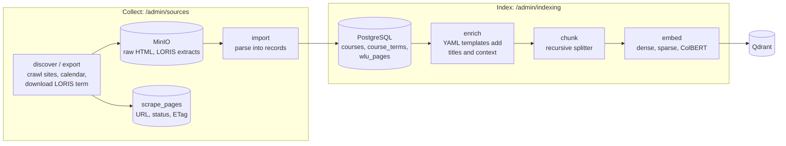
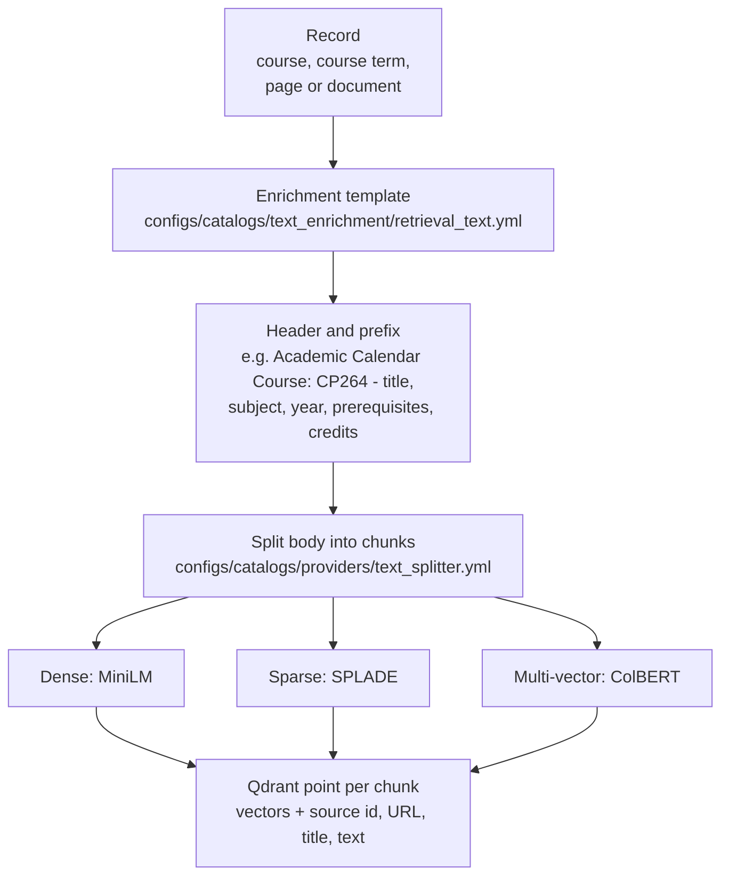

# Building the knowledge base

Ingestion is split into separate, independently runnable **jobs**. Each job records its own run
and batch state in PostgreSQL, so success at one stage is never reported as success of the whole
pipeline, and a failed stage can be retried without redoing work that already succeeded.

- [Pipeline](#pipeline)
- [Sources](#sources)
- [Jobs, modes and retries](#jobs-modes-and-retries)
- [Chunk and enrich: from a record to vectors](#chunk-and-enrich-from-a-record-to-vectors)
- [Document uploads](#document-uploads)
- [Running ingestion](#running-ingestion)
- [Limits and known gaps](#limits-and-known-gaps)

Scheduled runs (GitHub Actions, service keys, recovery): [nightly ingestion](nightly-ingestion.md).

---

## Pipeline



Every arrow between boxes is a separate job. Collection writes source objects and records;
indexing reads records and writes vectors. Re-indexing never requires re-crawling, and re-parsing
never requires re-downloading (the raw HTML is kept in MinIO).

## Sources

| Source | Discover / export | Import | Stored as |
| --- | --- | --- | --- |
| **Academic Calendar** | Crawls the calendar for an academic year and records which pages exist | Parses course and program pages in batches | `courses`, `wlu_pages` (programs, glossary) |
| **WLU websites** (`wlu`, `students_wlu`, `scholars_wlu`) | Breadth-first crawl seeded from sitemaps, restricted to each site's allowed domains (`configs/catalogs/scraping/websites.yml`) | Extracts title and body text in batches | `wlu_pages` |
| **LORIS registration** | Downloads one term's offerings (`term_code`, e.g. `202609`) | Loads the saved extract into course terms | `course_terms`, `course_term_meetings`, `course_term_faculty` |

The crawler (`application/services/simple_scraping/`) is an async crawler on `httpx`: every URL,
including redirects, passes the site profile's rules and `robots.txt`; a network failure on one page
is stored as retryable and the crawl continues. Parsing uses BeautifulSoup.

**Provenance.** The Academic Calendar describes a course; LORIS describes a term's sections. They
can disagree (credits, prerequisites), so both are stored with their source and neither silently
overwrites the other.

## Jobs, modes and retries

Every collection and indexing endpoint returns **`202 Accepted`** with a `run_id` and a
`status_url`. Accepting a request is not completing it: poll `GET /api/v1/admin/jobs/{run_id}`.

```
queued -> running -> success | partial_success | failed | cancelled
```

| Mode | Crawl | Import / index |
| --- | --- | --- |
| `fresh` | Start from the seeds and fetch everything | Process every record |
| `update` | Re-check stored pages with conditional requests (ETag / Last-Modified); `304` keeps the stored copy | Process only records flagged as changed (`needs_embedding`, changed source) |
| `retry` | Re-fetch pages that ended in a retryable error | Re-run only the **failed batches** of the last run |

How runs stay correct (`application/services/jobs/`):

- **Batches.** Large jobs page through a table in id order with bounded concurrency. A failed batch
  never aborts the others; it is stored `failed`, and `retry` replays exactly those offsets.
- **Per-record failures.** One record failing doesn't stop its batch. The batch fails listing those
  records, which stay flagged so `retry` or `update` picks them up.
- **Safe replacement.** A record's old vectors are deleted only after all new vectors were
  generated, so a failure keeps the previous version searchable.
- **No overlap.** A second run of the same job name is refused (`409`) while one is queued or
  running, across every backend instance (PostgreSQL advisory lock).
- **Recovery.** Running jobs send heartbeats. On shutdown, interrupted runs are recorded as failed.
  After a hard crash, a periodic zombie sweep fails runs whose heartbeat stopped (default: five
  minutes), and their unfinished batches become retryable. Nothing is replayed automatically.
- **Audits.** Crawl and import jobs finish with an audit (page counts by status), stored on the run.

One-shot work (a whole crawl, a LORIS export) uses the same run/batch model with a single batch,
so every job shares one status and history view.

## Chunk and enrich: from a record to vectors



1. **Enrich.** A chunk on its own often lacks context ("Prerequisites: CP104" doesn't say which
   course). Per record type (course, program, department, glossary, service page, ...) a YAML
   template renders a header with the facts that identify it. Strategies (`minimal`, `deep`, ...)
   trade token overhead for context and are chosen per collection.
2. **Chunk.** `RecursiveTextSplitter` (LangChain) splits on paragraphs, then lines, then words.
   Sizes range from small (300 characters) to large (1,500), with overlap, chosen per collection.
3. **Embed.** Each chunk is embedded with every vector type its collection defines. Local models
   run in the embedding service; cloud embeddings (Gemini, OpenAI) are also supported.
4. **Store.** Points go to the collection named by the profile (`configs/catalogs/profiles/
   vector_collection.yml`). Each collection has a `version`; changing its chunking or vectors means
   bumping the version, and provisioning refuses to start against a mismatched existing collection.

## Document uploads

Admins can upload files (`POST /api/v1/admin/documents/upload`). Text is extracted (PDF via pypdf),
the original is stored in MinIO, and the text is embedded. The document id is a hash of the
extracted text, so re-uploading the same content replaces its vectors. Planned: course syllabi and
faculty-provided documents as first-class sources; deleting documents is not implemented yet
(`501`).

## Running ingestion

Order: collect sources, then index them.

1. `POST /api/v1/admin/sources/academic-calendar/discover`, then `.../import`
2. `POST /api/v1/admin/sources/websites/discover` and `.../import` for each site
3. `POST /api/v1/admin/sources/registration/export` and `.../import` for each LORIS term
4. `POST /api/v1/admin/indexing/{courses,course-terms,pages}/sync`

These are admin operations. Locally, the default `LOCAL_ADMIN=true` makes this machine an admin with
sign-in off ([security](security.md#local-admin-without-sign-in)); otherwise sign in as an admin
(the development realm's `KC_TEST_ADMIN_USERNAME` user) or use a service key with the required scopes
([security](security.md#service-clients)). Interactive API docs are at `/docs` for admins. `scripts/nightly_ingestion.py` runs the whole sequence in order and is
what the scheduled workflow uses.

## Limits and known gaps

- Jobs run as tasks inside the API process, not on a durable queue. A restart interrupts them
  (recorded as failed and retryable). A separate worker would be a new adapter for the same job
  ports.
- Different job names can work on related data at the same time; the nightly workflow orders its
  stages, but there is no global ingestion lock.
- An unavailable `robots.txt` is treated as "disallowed", which is logged but can produce a
  successful crawl with no fetched pages. Check crawl audits, not only statuses.
