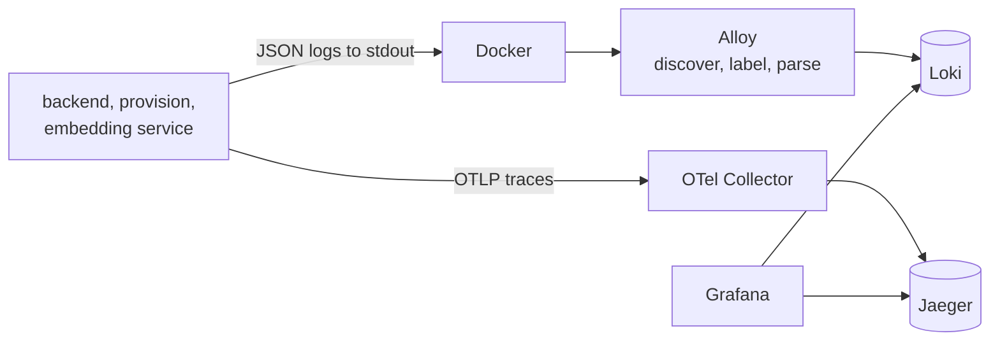

# Observability

The `observability` profile runs the full stack locally; every service is already instrumented.

| URL | What |
| --- | --- |
| http://localhost:3000 | Grafana: logs (Loki) and traces (Jaeger), linked both ways |
| http://localhost:16686 | Jaeger UI |

## Logs

- Every Python service logs with `structlog`: one JSON object per line, with `request_id`,
  `trace_id`, the event name and structured fields. Token-like fields are redacted.
- Alloy reads container logs from the Docker socket and pushes them to Loki with a few
  low-cardinality labels: `service_name` (the Compose service), `container`, `level` and `host`
  (`MACHINE_NAME`). `trace_id` is kept as structured metadata rather than a label, so it is
  searchable without creating one index stream per request.
- Useful queries: `{service_name="backend", level="error"}`, `{host="pc"}`, or filter a request by
  its `trace_id`.
- Container logs rotate (`CONTAINER_LOG_MAX_SIZE`, three files).
- Questions and answers are logged (`chat_question_received`, `chat_answer_completed`) so answers
  can be reviewed; treat log retention and access as student data.

## Traces

- OpenTelemetry instrumentation covers FastAPI, httpx and SQLAlchemy, plus explicit spans on key
  steps (`@traced`, e.g. `router.route`). Traces go over OTLP to the Collector, then to Jaeger.
- Every request carries a `request_id` and `trace_id`; both are returned in error responses, so a
  user-reported error leads straight to its trace and logs.
- Jaeger keeps traces in memory in development (they are lost on restart). Durable trace storage is
  a deployment decision.
- Set `OTEL_EXPORTER_OTLP_ENDPOINT` to a remote collector, or to empty to disable export locally.

## Grafana

Data sources are provisioned from `deploy/grafana/datasources.yaml`: Loki derives a link from each
log line's `trace_id` to Jaeger, and Jaeger links each span back to that request's logs.

## Timings worth watching

Each chat answer logs `retrieval_timings` (`routing_ms`, `structured_ms`, `vector_search_ms`) and
`chat_answer_completed` (`retrieval_ms`, `first_chunk_ms`, `generation_ms`, `total_ms`). Job runs
record their progress, batches and audits in PostgreSQL (`GET /api/v1/admin/jobs/{run_id}`).

## Multiple machines

Run the full `observability` profile on one machine. Every other machine runs only `log-shipper`
(Alloy) with `LOKI_PUSH_URL` pointing at that machine and sends traces there through
`OTEL_EXPORTER_OTLP_ENDPOINT`. `MACHINE_NAME` labels each log line with its source host.
